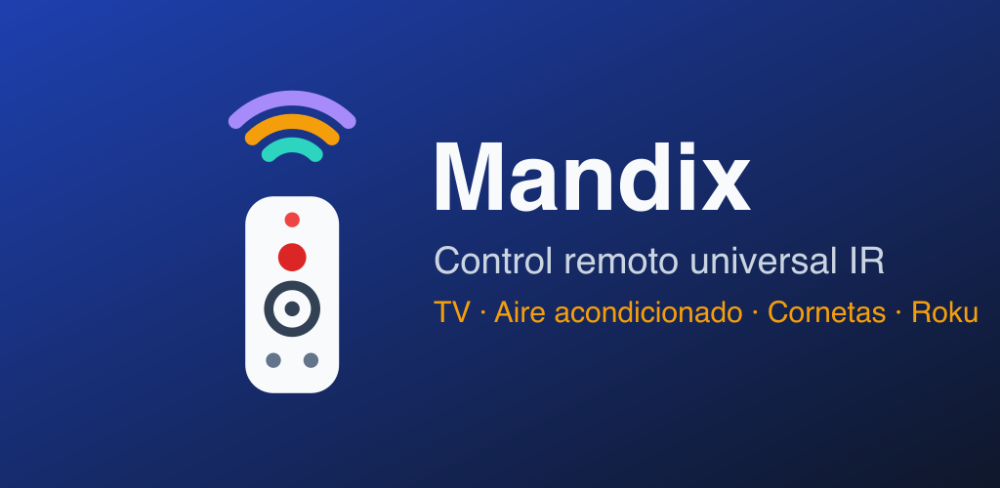

<h1 align="center">
  <br>
  Mandix · IR Universal Remote for Android
</h1>

<p align="center">
  <a href="https://github.com/MetalSyntax/Mandix-Multicontrol/releases/latest"></a>
  
  
  <a href="LICENSE"></a>
</p>

<p align="center">
  <a href="#-status">Status</a> •
  <a href="#-supported-devices">Devices</a> •
  <a href="#-install">How to install</a> •
  <a href="#-finding-your-code">Finding your code</a> •
  <a href="#known-issues">Known Issues</a> •
  <a href="#build-instructions-for-developers">How to compile</a> •
  <a href="#credits--acknowledgments">Credits</a>
</p>

**Mandix** (formerly *RM-014S+ Universal Control*) turns a phone with an **infrared emitter (IR blaster)** into a universal remote for every device in the house: TVs, air conditioners, Bluetooth speakers, stereos, LED lights, Roku and Fire TV. Each remote is drawn to look like the original one, the app remembers the code that works, and everything IR runs **offline** — no account, no cloud, no ads.

It started as a native Android recreation of the generic **RM-014S+** Chinese universal remote and grew into a multi-device remote with its own IR encoder.

---

## ✨ Status

**Current version: v4.3** — usable daily on the developer's own devices.

- [x] **Native IR encoder**: NEC / NECext / NEC42, Samsung32, Sony SIRC (12/15/20), RC5/RC5X, RC6, Panasonic/Kaseikyo, JVC, Sharp, RCA, Pioneer and raw timings, each with its own carrier (36–40 kHz, `AUTO` per protocol).
- [x] **TV library**: thousands of codes (Samsung, LG, Sony, TCL, Hisense, Philips, Panasonic, Sharp, Haier, Hitachi, Daewoo, AOC…) plus the 38 brand presets of the original RM-014S+.
- [x] **Auto search**: sweeps POWER or VOL− like a physical universal remote, with *1 back / test / save*.
- [x] **Deep NEC search** for unbranded Chinese TV boards (resumable, ~15–40 min) and a full `0x00–0xFF` NEC sweep.
- [x] **Air conditioners**: full state (temperature, mode, fan) for **Gree**, **Midea / Coolix** and their white-label brands, plus 150+ on/off models.
- [x] **Speakers & stereos**: generic 21-key Chinese Bluetooth speaker remote, AIWA mini systems, soundbars.
- [x] **Learn / remap mode**: if a key doesn't match, assign it another signal until it works.
- [x] **Roku over Wi-Fi** (External Control Protocol, port 8060) and **Fire TV over Wi-Fi** (ADB, via [dadb](https://github.com/mobile-dev-inc/dadb)) for keys that IR can't reach.
- [x] **Compatibility mode** for phones with buggy IR drivers (MediaTek: Tecno, Infinix, some Xiaomi).
- [x] **Camera test**: fires a burst so you can see the IR LED through another phone's camera.
- [x] **Spanish & English** UI (follows the system language).

---

## 📺 Supported Devices

| Remote | Link | What it controls |
| :--- | :---: | :--- |
| **Amazon / Fire TV** | IR + Wi-Fi (ADB) | TV power/volume by IR, Fire TV navigation by network |
| **Roku** | IR + Wi-Fi (ECP) | Full Roku remote, Netflix / Disney+ / Hulu / Sling shortcuts |
| **Speaker (living room)** | IR | Generic Chinese Bluetooth speaker (21 keys) |
| **Speaker (bedroom)** | IR | Custom layout + learn mode |
| **AC (bedroom / living room)** | IR | Gree, Coolix, Midea — temperature, mode, fan |
| **Generic light** | IR | 24-key RGB LED strip remotes (two common code tables) |
| **Magic Home** | IR | Magic Home LED controllers (extra keys via learn mode) |

> [!NOTE]
> IR keys need a phone with an IR blaster (common on Xiaomi/Redmi/POCO, Huawei/Honor, Tecno, Infinix and older LG/Samsung flagships). Without one, only the Wi-Fi remotes (Roku, Fire TV) work.

---

## 📲 Install

1. Download **`Mandix-v4.3.apk`** from the [latest release](https://github.com/MetalSyntax/Mandix-Multicontrol/releases/latest).
2. Open it on the phone and allow *Install unknown apps* for your browser/file manager when Android asks.
3. Open **Mandix**, pick a remote from the tabs at the top and point the top of the phone at the device.

**Wi-Fi remotes (optional):**
- **Roku**: *Settings → System → Advanced system settings → Control by mobile apps → Permissive*, then enter the Roku's IP in the app.
- **Fire TV**: *Settings → My Fire TV → Developer options → ADB debugging → On*, enter its IP and accept the *Allow USB debugging?* prompt on the TV the first time.

> [!TIP]
> The release APK is signed with a debug key. If you had an older Mandix/RM-014S+ build signed with a different key, uninstall it first.

---

## 🔍 Finding your code

1. Tap **📡 SEARCH** and choose a mode (universal library POWER is the recommended start).
2. Point at the device and press **START**. When the device reacts, press **STOP / SAVE**.
3. If the sweep already moved on, use **⏮ 1 BACK** and **🔊 TEST** until you land on the right code.
4. Already know your brand? Use the brand selector (codes `001–038` are the RM-014S+ presets) or the ◀ ▶ arrows on the remote.

---

## Known Issues

- **Not every TV responds**: some TVs (e.g. a tested "Premium"-branded set) ignore every code found so far. Deep NEC search is the best bet for unbranded boards.
- **MediaTek IR drivers** may invert polarity or drop repeat frames. Turn on *compatibility mode* and keep the phone within ~1–2 m. Details in [`DIAGNOSTICO_HARDWARE_Y_FALLAS.md`](DIAGNOSTICO_HARDWARE_Y_FALLAS.md) (Spanish).
- **Fire TV** keeps one ADB authorization per phone; if it was revoked on the TV, accept the prompt again.
- Some AC brands only get on/off (no full state) when they don't use the Gree/Coolix/Midea protocols.

---

## Build Instructions (For Developers)

### Prerequisites

- JDK 17
- Android SDK (compile SDK 34) — Android Studio or the command-line tools.

### Compilation Commands

```bash
git clone https://github.com/MetalSyntax/Mandix-Multicontrol.git
cd Mandix-Multicontrol
./gradlew assembleDebug
# APK → app/build/outputs/apk/debug/app-debug.apk
```

Every push to `main` is also built by GitHub Actions (`.github/workflows/build.yml`) and the APK is uploaded as a workflow artifact.

### Project layout

```text
app/src/main/kotlin/com/example/rm014s/
  IrCodec.kt          IR protocol encoders → timing arrays
  AcCodec.kt          stateful AC frames (Gree, Coolix, Midea)
  IrManagerHelper.kt  ConsumerIrManager wrapper + compatibility mode
  WifiControl.kt      Roku ECP and Fire TV ADB links
  SkinRemotes.kt      remote definitions (layout, protocol, built-in codes)
  MainActivity.kt     tabs, auto search, brand selector
app/src/main/assets/*.ir   code libraries (TV, audio, AC)
tools/                     scripts that generate the libraries and store art
play/                      Google Play listing + icon/feature graphic
```

---

## Credits & Acknowledgments

- **[IRremoteESP8266](https://github.com/crankyoldgit/IRremoteESP8266)** — Gree, Coolix and Midea AC protocols (`AcCodec.kt` is a Kotlin port, LGPL-2.1).
- **[Flipper-IRDB](https://github.com/Lucaslhm/Flipper-IRDB)** and **[IRDB](https://github.com/probonopd/irdb)** — TV, audio, Roku and LED code libraries.
- **[dadb](https://github.com/mobile-dev-inc/dadb)** by mobile.dev for the Fire TV ADB connection.
- Original **RM-014S+** remote (generic Chinese universal remote) as the design reference.
- Developed by [MetalSyntax](https://github.com/MetalSyntax).

## License

Released under the [MIT License](LICENSE), except `AcCodec.kt`, which is derived from IRremoteESP8266 and stays under LGPL-2.1. Brand names and trademarks belong to their respective owners; Mandix is not affiliated with any of them.
